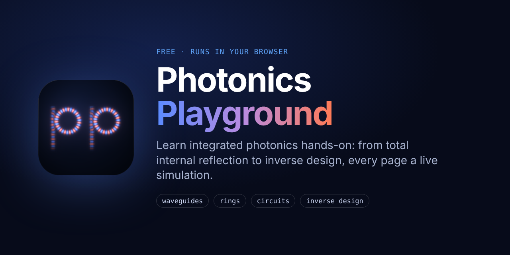

<p align="center"></p>

# Photonics Playground

**Learn integrated photonics hands-on.** Every page is a live simulation that runs entirely in your browser, on any device, with nothing to install.

**▶ Open the playground: https://YOUR-ORG.github.io/photonics-playground/**

## What's inside

| Chapter | Tools |
|---|---|
| 1 · How light is guided | How Light Is Guided, Waveguide Mode Solver |
| 2 · Classic building blocks | Component Workshop (directional coupler, Y-splitter, MMI, ring resonator, grating coupler) |
| 3 · Inverse design | How Inverse Design Works, Inverse Design 2D, Grating Coupler Optimizer, Design Studio |

Under the hood

- a finite-difference eigenmode solver for waveguide cross-sections (quasi-TE and quasi-TM)
- a 2D frequency-domain finite-difference (FDFD) wave solver with absorbing boundaries and mode sources and monitors
- adjoint gradients with an Adam optimizer, density filtering and projection for inverse design

All computation happens locally in the browser (JavaScript and Web Workers). There is no server and no account. Anonymous, cookieless visitor statistics are collected with GoatCounter (set `goatcounter` to `''` in `build.py` to disable).

## Run it locally

Open `docs/index.html` in a browser, or serve the folder:

```bash
python3 -m http.server --directory docs
```

## Build

The website in `docs/` is generated from `src/`:

```bash
python3 build.py
```

Before publishing, fill in the `CONFIG` block at the top of `build.py` (name, place and contact for the legal notice, GitHub organization), then rebuild.

```
build.py            build script (edit CONFIG here)
src/pages/          the tool pages
src/hub-index.html  landing page
src/teach.css       shared styles
src/fonts/          self-hosted fonts (woff2) and fonts.css
src/brand/          logo, banner
src/thumbs/         thumbnails for the landing page
docs/               the generated website, served by GitHub Pages
```

## License

- Code under the [MIT License](LICENSE).
- Texts, figures, images and videos under [CC BY 4.0](LICENSE-CONTENT).
- Fonts Instrument Sans and IBM Plex Mono under the SIL Open Font License 1.1.

## Citation

If you use Photonics Playground in teaching or research, please cite it. GitHub shows a "Cite this repository" button based on [CITATION.cff](CITATION.cff).

Feedback and bug reports are welcome as [issues](../../issues).
